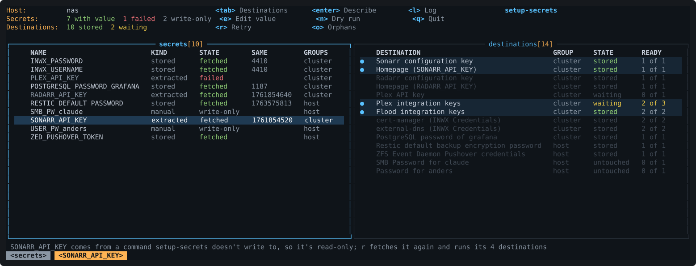
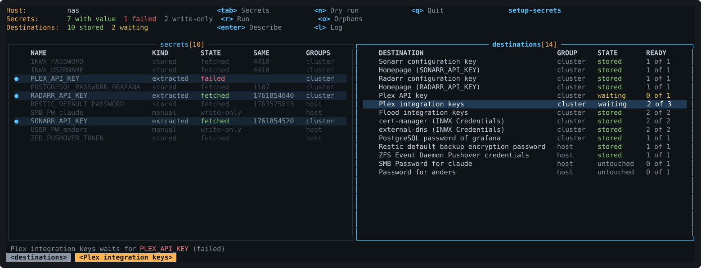
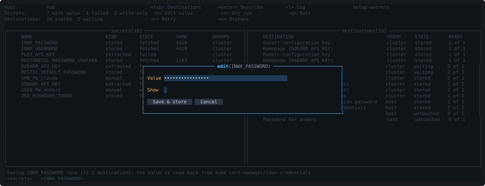
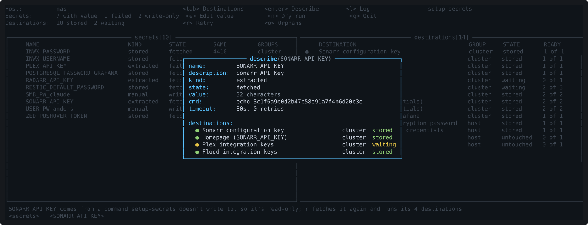
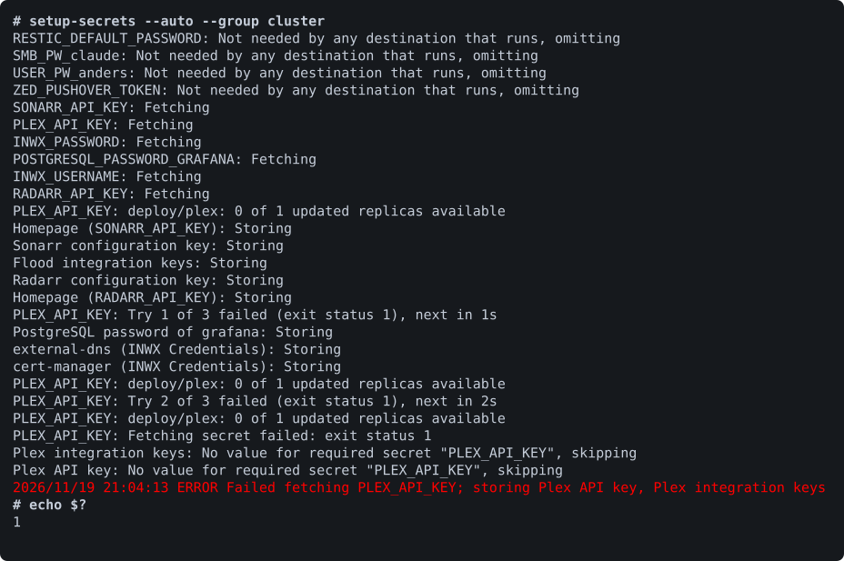

# nixos-setup-secrets

A NixOS module and CLI for setting up secrets on a machine without ever
storing them -- encrypted or not -- in the Nix store or your git repo.

Instead of encrypting secrets into your flake the way
[sops-nix](https://github.com/Mic92/sops-nix) or
[agenix](https://github.com/ryantm/agenix) do, you declare *sources* (where
a secret's value comes from) and *destinations* (what to do with it once
you have it). Running `setup-secrets` fetches whatever sources have a fetch
command, lets you review and fill in the rest in a terminal form, and then
runs your destination commands with the values as environment variables --
so a secret only ever exists on the target machine, for as long as it takes
to hand it off to wherever it's actually needed.

## Setup

Add `nixos-setup-secrets` to your `flake.nix` and import the module:

```nix
{
  inputs = {
    ...
    setup-secrets = {
      url = "github:andsens/nixos-setup-secrets";
      inputs.nixpkgs.follows = "nixpkgs";
    };
    ...
  };
  ...
}
```

```nix
{ inputs, ... }:
{
  imports = [ inputs.setup-secrets.nixosModules.default ];
  config.setup-secrets.enable = true;
}
```

## Declaring secrets

```nix
{
  setup-secrets = {
    sources.DB_PASSWORD.description = "Database password";
    destinations = [
      {
        logPrefix = "App database password";
        requires = [ "DB_PASSWORD" ];
        cmd = ''printf '%s' "$DB_PASSWORD" >/run/secrets/db-password'';
      }
    ];
  };
}
```

A source with no `cmd` has to be filled in by hand in the form. Give it one
and it's fetched automatically instead -- from a password manager CLI, a
KMS, wherever:

```nix
setup-secrets.sources.DB_PASSWORD.cmd = "op read op://vault/db/password";
```

A destination's `cmd` runs with every secret listed in `requires` available
as an environment variable named after the source; if any required secret
has no value, the destination is skipped. `wants` secrets are injected the
same way when available, but don't block the destination if they're
missing.

## Running it

```
$ sudo setup-secrets
```

Opens a TUI with every secret on the left and every destination on the
right. Sources with a `cmd` are fetched when it starts; nothing is stored
until you ask. Selecting a secret highlights the destinations that need it,
and `tab` turns it around: selecting a destination highlights the secrets it
needs, with what keeps it waiting at the bottom.





`e` edits a secret and stores it right away through the destinations that
need it, fetching the other values they need again first. There is no
separate save step. A secret can be edited when it has no `cmd`, or when
the source names the place it reads the value back from with `storedIn`, so
the edit sticks. A source that reads from somewhere setup-secrets never
writes (an API key extracted from the configuration of a service, KIND
`extracted`) is shown read-only: an edit would be fetched over on the next
run.



A secret without a `cmd` shows as `write-only`: its value only exists where
its destination wrote it, so the TUI can't show it, only set a new one. A
destination that only lacks such secrets is `untouched`: it keeps what it
stored before.



| Key     | What it does                                                        |
|---------|---------------------------------------------------------------------|
| `tab`   | Switch between the secrets and the destinations (or click the other pane) |
| `e`     | Edit the selected secret, and store it                              |
| `r`     | Fetch the selected secret again and run the destinations that need it, or run the selected destination |
| `enter` | Describe the selection in a modal: commands, `storedIn`, what it is linked to (or double-click it) |
| `n`     | Dry run: mark each destination as one `--changed-only` would run or skip, with the reason |
| `o`     | The orphans: outputs no destination declares any more; `d` deletes one |
| `l`     | The log of everything fetched and stored                            |
| `q`     | Quit (or close the log or description)                              |

Values are masked unless you tick "Show" while editing.

```
$ sudo setup-secrets --auto
```

Skips the form entirely -- fetches and stores in one pass. `--group <name>`
runs only the destinations of that group, and fetches only what they need.



`--auto` fetches a few sources at a time and runs each destination as soon
as every secret it needs is in, so a source that waits for a service doesn't
hold up the destinations that service is waiting for.

It exits with 1 when a fetch command fails, when a destination fails, or
when a destination is skipped because the command of a required secret
failed. A secret without a value yet doesn't count: one without a `cmd`, or
one whose `cmd` succeeds without printing anything (say, a Secret nobody has
created yet). Only someone typing it in can supply that value. A unit or a
test running `--auto` fails with the real cause, in place of whatever was
waiting for the secret failing later.

## Running it automatically

Turn on `setup-secrets.autoSetup` for one unit per group of destinations,
`setup-secrets@<group>.service`, instances of the template
`setup-secrets@.service`. Destinations are in the group `host` unless they set
`group`. The `host` group runs at boot, before `sysinit.target`, and again on
every `nixos-rebuild switch` before any other unit is started. Other groups
run when something pulls them in, which suits secrets that live in a
service that has to be up first:

```nix
{
  setup-secrets.destinations = [
    {
      logPrefix = "Sonarr configuration key";
      group = "cluster";
      requires = [ "SONARR_API_KEY" ];
      cmd = "...";
    }
  ];
  # Runs after every start of k3s and stops with it
  systemd.services."setup-secrets@cluster" = {
    wantedBy = [ "k3s.service" ];
    partOf = [ "k3s.service" ];
    after = [ "k3s.service" ];
  };
}
```

A group needs an entry in `setup-secrets.groups` only to change its
settings, or to make sure the unit exists before any destination is in it
(so the wiring above never points at a unit that isn't there):

```nix
setup-secrets.groups.cluster = { };
```

Sources and destinations take a `timeout` (default `30s`) and a number of
`retries` with backoff (1s, 2s, 4s and so on, up to 30s between tries), for
commands that talk to something still starting:

```nix
setup-secrets.sources.PLEX_API_KEY = {
  cmd = "kubectl exec -n plex deploy/plex -- ...";
  timeout = "2m";
  retries = 3;
};
```

`journalctl -u setup-secrets@cluster` shows what a group did, one line per
source and destination, prefixed with the name of the source or destination.

## Only what changed

A run with `--changed-only`, which the units pass, skips the destinations
that would store the same thing again. A destination runs when it never
stored, when the command of the destination changed, when one of the
declared `outputs` is gone, or when a secret it needs changed. A secret
changed when the `cmd` of the source did, or when the `same` command prints
a different token: something cheap that changes with the value, without
fetching it.

```nix
setup-secrets = {
  sources.RESTIC_DEFAULT_PASSWORD = {
    cmd = "cat /etc/secrets.d/restic-default-encryption.key";
    same = "stat -c %Y /etc/secrets.d/restic-default-encryption.key";
  };
  destinations = [
    {
      logPrefix = "Restic default backup encryption password";
      requires = [ "RESTIC_DEFAULT_PASSWORD" ];
      cmd = ''printf "%s" "$RESTIC_DEFAULT_PASSWORD" >/etc/secrets.d/restic-default-encryption.key'';
      outputs = [ "file:/etc/secrets.d/restic-default-encryption.key" ];
    }
  ];
};
```

A secret without `same` always counts as changed, so the destinations that
need it always run. The tokens are taken after storing, as a destination
that writes what the source reads changes the token.

setup-secrets keeps what it needs for this in `stateFile`
(`/var/lib/setup-secrets/state.json`): the names, command strings and
tokens, and the outputs it wrote. Never the values.

## Cleaning up

A destination that goes away, because a module was disabled say, leaves
the outputs it wrote behind. setup-secrets records every output it writes, so it can
find them:

```
$ sudo setup-secrets cleanup
kube:homepage/sonarr-api-key                       written by Homepage (SONARR_API_KEY), 2026-11-19 23:57

setup-secrets cleanup --delete deletes them.
```

Cleanup never runs by itself: a destination enabled again later gets a new
value only if the source can make one, and a generated password that no
longer matches what a service has is worse than a stale Secret.

An output is `<kind>:<id>`. The kind says how to check and delete it, with
the id as `$OUTPUT`: `exists` exits 0 when the output is there and 1 when it
isn't. `file` is built in; anything else is yours to define:

```nix
setup-secrets.outputKinds.kube = {
  exists = ''
    out=$(kubectl -n "''${OUTPUT%%/*}" get secret "''${OUTPUT#*/}" --ignore-not-found -oname) || exit 2
    [[ -n $out ]]
  '';
  delete = ''kubectl -n "''${OUTPUT%%/*}" delete secret "''${OUTPUT#*/}" --ignore-not-found'';
};
```

## Recipes

**Read back what a destination wrote**: most secrets have no other home
than where they end up. A source that reads them back from there keeps the
value across runs, and the form shows it pre-filled:

```nix
setup-secrets = {
  sources.RESTIC_DEFAULT_PASSWORD = {
    cmd = "cat /etc/secrets.d/restic-default-encryption.key";
    # The TUI lets you edit it, as the edit is read back from here
    storedIn = "/etc/secrets.d/restic-default-encryption.key";
  };
  destinations = [
    {
      logPrefix = "Restic default backup encryption password";
      requires = [ "RESTIC_DEFAULT_PASSWORD" ];
      cmd = ''printf "%s" "$RESTIC_DEFAULT_PASSWORD" >/etc/secrets.d/restic-default-encryption.key'';
    }
  ];
};
```

**Generate a value once**: generate only when the value doesn't exist yet,
and fail when you can't tell, so a value is never replaced because something
was briefly unreachable:

```nix
setup-secrets.sources.POSTGRESQL_PASSWORD_GRAFANA.cmd = ''
  if [[ -e /etc/secrets.d/grafana-db.pw ]]; then
    cat /etc/secrets.d/grafana-db.pw
  else
    head -c 1024 /dev/urandom | tr -dc A-Za-z0-9 | head -c 32
  fi
'';
```

**Seal it to the TPM**: a destination can hand the value to
`systemd-creds`, and the source can read it back the same way:

```nix
setup-secrets = {
  sources.ZED_PUSHOVER_TOKEN.cmd = "systemd-creds decrypt /etc/credstore.encrypted/zed-pushover-token -";
  destinations = [
    {
      logPrefix = "ZFS Event Daemon Pushover token";
      requires = [ "ZED_PUSHOVER_TOKEN" ];
      cmd = ''
        printf "%s" "$ZED_PUSHOVER_TOKEN" |
          systemd-creds encrypt --with-key=tpm2 --name=zed-pushover-token - /etc/credstore.encrypted/zed-pushover-token
      '';
    }
  ];
};
```

**Keep values off argv**: secrets arrive as environment variables, which
other users can't read; a value on a command line shows up in `ps` for
everyone. Pipe it in (`printf "%s" "$SECRET" | tool --stdin`) or write it to
a file with `umask 077`, as the examples above do.

## User passwords

`setup-secrets.users.enable` wires up a source and destination for every
user with a `hashedPasswordFile` set: it prompts for their password in the
form and writes the hashed result to that file, so the plaintext password
never touches disk.

```nix
{
  setup-secrets.users.enable = true;
  users.users.anders.hashedPasswordFile = "/persist/passwd/anders";
}
```

For the full list of module options, see [docs/options.md](docs/options.md).
