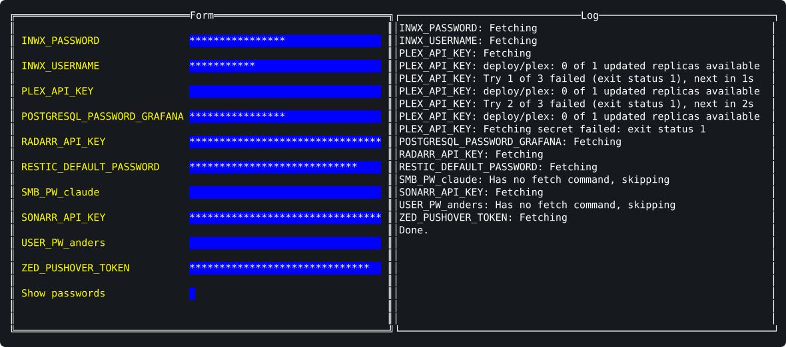

# nixos-setup-secrets

A NixOS module and CLI for setting up secrets on a machine without ever
storing them -- encrypted or not -- in the Nix store or your git repo.

Instead of encrypting secrets into your flake the way
[sops-nix](https://github.com/Mic92/sops-nix) or
[agenix](https://github.com/ryantm/agenix) do, you declare *sources* (where
a secret's value comes from) and *destinations* (what to do with it once
you have it). Running `setup-secrets` fetches whatever sources have a fetch
command, lets you review and fill in the rest in a terminal form, and then
runs your destination commands with the values as environment variables --
so a secret only ever exists on the target machine, for as long as it takes
to hand it off to wherever it's actually needed.

## Setup

Add `nixos-setup-secrets` to your `flake.nix` and import the module:

```nix
{
  inputs = {
    ...
    setup-secrets = {
      url = "github:andsens/nixos-setup-secrets";
      inputs.nixpkgs.follows = "nixpkgs";
    };
    ...
  };
  ...
}
```

```nix
{ inputs, ... }:
{
  imports = [ inputs.setup-secrets.nixosModules.default ];
  config.setup-secrets.enable = true;
}
```

## Declaring secrets

```nix
{
  setup-secrets = {
    sources.DB_PASSWORD.description = "Database password";
    destinations = [
      {
        logPrefix = "App database password";
        requires = [ "DB_PASSWORD" ];
        cmd = ''printf '%s' "$DB_PASSWORD" >/run/secrets/db-password'';
      }
    ];
  };
}
```

A source with no `cmd` has to be filled in by hand in the form. Give it one
and it's fetched automatically instead -- from a password manager CLI, a
KMS, wherever:

```nix
setup-secrets.sources.DB_PASSWORD.cmd = "op read op://vault/db/password";
```

A destination's `cmd` runs with every secret listed in `requires` available
as an environment variable named after the source; if any required secret
has no value, the destination is skipped. `wants` secrets are injected the
same way when available, but don't block the destination if they're
missing.

## Running it

```
$ sudo setup-secrets
```

Opens a terminal form: sources with a `cmd` are fetched and pre-filled,
everything else is left for you to type in. Hit "Save" to run the
destinations.



```
$ sudo setup-secrets --auto
```

Skips the form entirely -- fetches and stores in one pass. `--group <name>`
runs only the destinations of that group, and fetches only what they need.


`--auto` exits with 1 when a fetch command fails, when a destination fails,
or when a destination is skipped because a required secret with a `cmd` has
no value. A destination waiting for a secret without a `cmd` doesn't count:
in an automatic run, only someone typing it in can supply that value. A unit
or a test running `--auto` fails with the real cause, in place of whatever
was waiting for the secret failing later.

## Running it automatically

Turn on `setup-secrets.autoSetup` for one unit per group of destinations,
`setup-secrets-<group>.service`. Destinations are in the group `host` unless
they set `group`. The `host` group runs at boot, before `sysinit.target`, and
again on every `nixos-rebuild switch` before any other unit is started. Other
groups run when something pulls them in, which suits secrets that live in a
service that has to be up first:

```nix
{
  setup-secrets.destinations = [
    {
      logPrefix = "Sonarr configuration key";
      group = "cluster";
      requires = [ "SONARR_API_KEY" ];
      cmd = "...";
    }
  ];
  # Runs after every start of k3s and stops with it
  systemd.services.setup-secrets-cluster = {
    wantedBy = [ "k3s.service" ];
    partOf = [ "k3s.service" ];
    after = [ "k3s.service" ];
  };
}
```

A group needs an entry in `setup-secrets.groups` only to change its
settings, or to make sure the unit exists before any destination is in it
(so the wiring above never points at a unit that isn't there):

```nix
setup-secrets.groups.cluster = { };
```

Sources and destinations take a `timeout` (default `30s`) and a number of
`retries` with backoff (1s, 2s, 4s and so on, up to 30s between tries), for
commands that talk to something still starting:

```nix
setup-secrets.sources.PLEX_API_KEY = {
  cmd = "kubectl exec -n plex deploy/plex -- ...";
  timeout = "2m";
  retries = 3;
};
```

`journalctl -u setup-secrets-cluster` shows what a group did, one line per
source and destination, prefixed with the name of the source or destination.

## Recipes

**Read back what a destination wrote**: most secrets have no other home
than where they end up. A source that reads them back from there keeps the
value across runs, and the form shows it pre-filled:

```nix
setup-secrets = {
  sources.RESTIC_DEFAULT_PASSWORD.cmd = "cat /etc/secrets.d/restic-default-encryption.key";
  destinations = [
    {
      logPrefix = "Restic default backup encryption password";
      requires = [ "RESTIC_DEFAULT_PASSWORD" ];
      cmd = ''printf "%s" "$RESTIC_DEFAULT_PASSWORD" >/etc/secrets.d/restic-default-encryption.key'';
    }
  ];
};
```

**Generate a value once**: generate only when the value doesn't exist yet,
and fail when you can't tell, so a value is never replaced because something
was briefly unreachable:

```nix
setup-secrets.sources.POSTGRESQL_PASSWORD_GRAFANA.cmd = ''
  if [[ -e /etc/secrets.d/grafana-db.pw ]]; then
    cat /etc/secrets.d/grafana-db.pw
  else
    head -c 1024 /dev/urandom | tr -dc A-Za-z0-9 | head -c 32
  fi
'';
```

**Seal it to the TPM**: a destination can hand the value to
`systemd-creds`, and the source can read it back the same way:

```nix
setup-secrets = {
  sources.ZED_PUSHOVER_TOKEN.cmd = "systemd-creds decrypt /etc/credstore.encrypted/zed-pushover-token -";
  destinations = [
    {
      logPrefix = "ZFS Event Daemon Pushover token";
      requires = [ "ZED_PUSHOVER_TOKEN" ];
      cmd = ''
        printf "%s" "$ZED_PUSHOVER_TOKEN" |
          systemd-creds encrypt --with-key=tpm2 --name=zed-pushover-token - /etc/credstore.encrypted/zed-pushover-token
      '';
    }
  ];
};
```

**Keep values off argv**: secrets arrive as environment variables, which
other users can't read; a value on a command line shows up in `ps` for
everyone. Pipe it in (`printf "%s" "$SECRET" | tool --stdin`) or write it to
a file with `umask 077`, as the examples above do.

## User passwords

`setup-secrets.users.enable` wires up a source and destination for every
user with a `hashedPasswordFile` set: it prompts for their password in the
form and writes the hashed result to that file, so the plaintext password
never touches disk.

```nix
{
  setup-secrets.users.enable = true;
  users.users.anders.hashedPasswordFile = "/persist/passwd/anders";
}
```

For the full list of module options, see [docs/options.md](docs/options.md).
